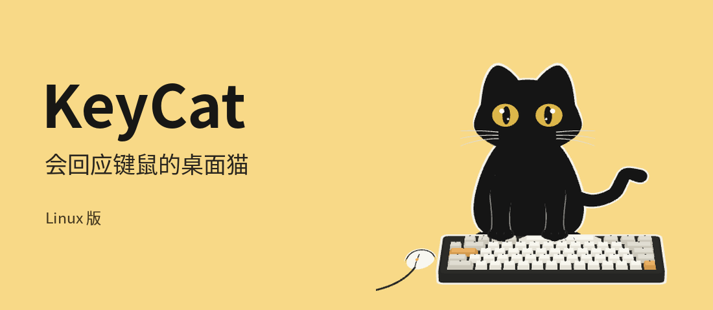
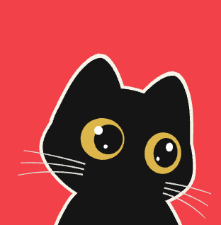

# KeyCat



KeyCat 是一只会回应键鼠的桌面猫。你打字，它伸爪按键。你移动鼠标，它会转头跟着看。摸头会让它眯起眼睛，安静一会儿它就会睡着。

本仓库维护 KeyCat 的 Linux 版，已经在 Ubuntu 上构建和试用。黑猫使用黑色爪子，耳根轮廓平滑接入脸颊，描边和帧率都可以在托盘里调整。

## 在 Ubuntu 上运行

装好 Rust 后，克隆本仓库并编译。

```sh
sudo apt install build-essential pkg-config libgtk-3-dev libwebkit2gtk-4.1-dev libayatana-appindicator3-dev libx11-dev libxext-dev
git clone https://github.com/10wdldw/KeyCat.git
cd KeyCat/win
cargo build --locked --release
./target/release/keycat
```

应用使用 GTK 和 WebKitGTK。在提供 XWayland 的 Wayland 会话中，默认使用 X11 后端来定位浮窗。用普通用户运行。若猫咪收不到其他窗口里的键鼠事件，检查当前用户对相应 `/dev/input/event*` 设备的读取权限。

## 使用

| 操作 | 方法 |
| --- | --- |
| 移动小猫 | 拖动猫的身体。按住头部会触发摸头 |
| 改变大小 | 右键托盘图标，选择「大小」 |
| 开关描边 | 「调节反应… → 画面 → 显示轮廓描边」。默认开启，关掉后会隐藏猫咪的外轮廓线 |
| 调整帧率 | 「调节反应… → 画面 → 最高帧率」。可设 20–120 FPS，空闲时约 20 FPS |
| 录屏时穿透鼠标 | 从托盘开启「鼠标穿透」。要继续拖动时，从托盘关闭它 |

描边和帧率都会即时更新并保存。实际帧率受屏幕刷新率和 WebView 性能限制。

<details>
<summary>小猫动作演示与耳根对比</summary>

上游的交互动图展示了打字、移动鼠标和摸头时的动作。


| 原版耳根 | 本版耳根 |
| --- | --- |
|  |  |

本版仅在耳根附近重新采样，用三次贝塞尔曲线接续耳侧切线，再向脸颊过渡。皮肤和描边沿用同一段轮廓变化。

</details>

## 开发

- `web/` 保存 three.js 场景、猫咪模型和共用设置。可在仓库根目录运行 `python3 tools/serve.py`，然后打开 `http://127.0.0.1:8765` 预览。
- `win/` 是 Linux 和 Windows 共用的 Tauri 外壳。在该目录运行 `cargo test --locked` 可执行 Rust 测试。
- `mac/` 保存上游的 Swift 外壳。Windows 和 macOS 官方安装包及构建发布说明见 [上游 KeyCat](https://github.com/ElloboDK/KeyCat)。

原项目由 [ElloboDK](https://github.com/ElloboDK) 创建。沿用上游关于个人使用和交流的说明。three.js 的许可证见 [THREE_LICENSE](web/THREE_LICENSE)。
