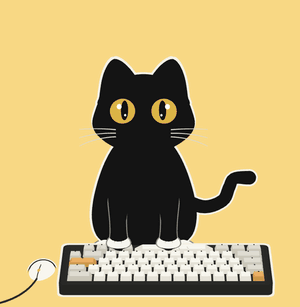
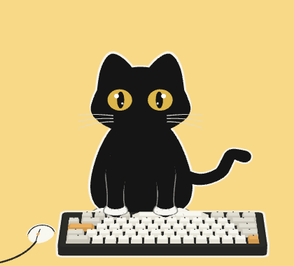

# KeyCat

一只趴在键盘上的桌面猫：你打字它伸爪按键，动鼠标它扭头看，摸头会闭眼，没人理会睡着，被烦到会用尾巴捶桌。上游支持 macOS 13+ 和 Windows 10+。本分支增加了实验性的 Linux 版本。



下载页：<https://ellobodk.github.io/KeyCat/>，会按访问者的系统给出对应的安装包，页面上的猫可以直接用键盘鼠标逗。

## Linux 版本



上面的静态图来自当前分支的场景。页面顶部是上游的交互动图。

- 在 Ubuntu 上通过 GTK、WebKitGTK 和 Tauri 运行。Wayland 会话有 XWayland 时默认使用 X11 后端。
- 从托盘的「大小」调整窗口，关闭「鼠标穿透」后可拖动猫身体。头部用于摸猫。
- 托盘「调节反应… → 画面」可设 20–120 FPS 的最高帧率，默认 120 FPS，即时应用并随设置保存。空闲时最高约 20 FPS，实际帧率还受屏幕刷新率和 WebView 限制。
- 耳根修复用与耳侧切线衔接的三次贝塞尔曲线过渡到脸颊。只替换耳根附近的采样点，皮肤与外描边使用相同的处理。

| 原版耳根 | 修复后的耳根 |
| --- | --- |
|  |  |

### 在 Ubuntu 上从源码运行

准备 Rust、编译工具及 GTK / WebKitGTK 依赖后，在仓库根目录运行。

```sh
sudo apt install build-essential pkg-config libgtk-3-dev libwebkit2gtk-4.1-dev libayatana-appindicator3-dev libx11-dev libxext-dev
cd win
cargo build --locked --release
./target/release/keycat
```

Linux 使用可读的 `/dev/input/event*` 设备响应全局键鼠事件。用普通用户运行；缺少读取权限时需由系统管理员按设备配置访问。读取输入设备的权限也能被该用户的其他程序使用。

## 安装

**macOS**：在终端执行

```sh
curl -L -o /tmp/KeyCat-macOS.zip https://github.com/ElloboDK/KeyCat/releases/latest/download/KeyCat-macOS.zip \
  && unzip -qo /tmp/KeyCat-macOS.zip -d /Applications && open /Applications/KeyCat.app
```

首次启动需在「系统设置 → 隐私与安全性 → 输入监控」里允许 KeyCat，然后重启应用。它只读取哪个键被按下，不记录输入内容。手动从浏览器下载时，若提示「已损坏」，执行 `xattr -dr com.apple.quarantine /Applications/KeyCat.app`。装在「应用程序」文件夹里的 KeyCat 会自动更新：启动 15 秒后和之后每 6 小时检查一次，有新版就在后台下载，退出时替换，也可以在菜单里点「重启并更新」。1.0.2 及更早的版本没有这个功能，需要用上面的命令重装一次。

**Windows**：从 [Releases](https://github.com/ElloboDK/KeyCat/releases/latest) 下载 `KeyCat-Windows-Setup.exe` 运行。SmartScreen 拦截时点「更多信息 → 仍要运行」。安装包只有几 MB，猫由系统自带的 WebView2 绘制，极少数没装 WebView2 的 Win10 会在安装时自动下载。应用会自动更新，1.0.x 的旧版会自动升级过来并保留设置。

## 使用

猫住在菜单栏（Windows 是托盘）。右键猫或点图标打开菜单，可以换毛色和外观、调大小、设置多久睡着，在「调节反应…」里调整烦躁和好奇的灵敏度。按住猫身体可以拖动位置。直播或录屏时可以打开「鼠标穿透」，点击会直接落到猫下面的窗口，猫照常显示和反应，这时菜单只能从菜单栏或托盘图标打开。

Windows 上很多游戏以管理员身份运行，普通权限的 KeyCat 收不到发给它们的按键，猫就不动了。在菜单里打开「以管理员身份运行」，KeyCat 会弹出 UAC 授权并以管理员身份重启，之后每次手动启动都会弹 UAC。开机自启这时改用计划任务，登录时直接以管理员身份启动，不弹 UAC。关掉这个选项后，要等 KeyCat 下次启动才恢复成普通权限。独占全屏的游戏会盖住所有窗口，这种情况下猫本身就看不到，请把游戏改成无边框窗口模式。

## 构建

```sh
sh mac/build.sh       # → build/KeyCat.app（通用二进制，需 Xcode 命令行工具）
sh mac/package.sh     # → dist/KeyCat-macOS.zip + .sha256 + latest-mac.json

cd win && npm ci
npm start             # 本机调试
npm run dist          # → win/target/release/bundle/nsis/KeyCat_<版本>_x64-setup.exe（需 Rust 和 Node.js 22+，在 Windows 上执行）
```

mac 版用 `signing/` 里自动生成的本地证书签名，这样重新编译后「输入监控」授权仍然有效。mac 自动更新只接受同一张证书签名的新版，所以发布包必须在有这个目录的机器上打，证书丢了已安装的 mac 版也收不到更新。Windows 自动更新的签名私钥也放在这里（`tauri-updater.key` 和它的密码 `tauri-updater.password`），内容同时存在仓库的 `TAURI_SIGNING_PRIVATE_KEY`、`TAURI_SIGNING_PRIVATE_KEY_PASSWORD` 两个 Secret 里，公钥写在 `win/tauri.conf.json`。私钥丢了已安装的版本就收不到更新，要另外备份。不要提交这个目录。

## 发布

mac 和 Windows 共用一个 Release，两边产物都要上传，否则另一端的下载链接或自动更新会失效。

1. 把 `win/package.json` 的 `version` 和 `mac/Info.plist` 的 `CFBundleShortVersionString` 改成同一个版本，`CFBundleVersion` 加 1，合入 main。
2. 执行 `sh mac/package.sh`，推送 `vX.Y.Z` tag，再执行 `gh release create vX.Y.Z --generate-notes dist/KeyCat-macOS.zip dist/KeyCat-macOS.zip.sha256 dist/latest-mac.json`。`latest-mac.json` 是 mac 版的更新清单，mac 版靠 `CFBundleVersion` 判断新旧，所以每次发布都要加 1。
3. tag 触发 GitHub Actions，几分钟后会把 Windows 安装包、`latest.json`（新版的更新清单）和 `latest.yml`（让 1.0.x 旧版升级过来）补传到同一个 Release。

## 目录

```
mac/    macOS 外壳（Swift）：浮窗、菜单、键鼠监听、自动更新、构建/签名/打包脚本
win/    Windows / Linux 外壳（Tauri，Rust）：托盘、全局键鼠钩子、自动更新，页面由系统 WebView2 绘制
web/    桌面版本共用的 three.js 场景：猫、键盘、动作，tuning.js 是可调参数的唯一来源
site/   下载页，由 .github/workflows/pages.yml 连同 web/ 一起部署到 GitHub Pages，每 3 小时刷新一次下载量
tools/  开发用渲染脚本（serve.py 起本地服务，readme_gif.py 生成 README 动图，其余脚本在内置浏览器里截图对比）
```

## 说明

这是一个从零实现的学习项目，形象和交互参考了一款付费桌面宠物应用，仅供个人使用和内部交流，不用于商业分发，也不包含对方的任何素材。three.js 为 MIT 许可（见 `web/THREE_LICENSE`），Tauri 为 MIT / Apache-2.0 双许可。
