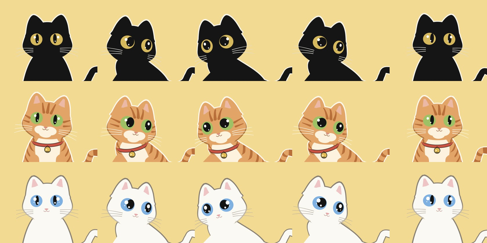
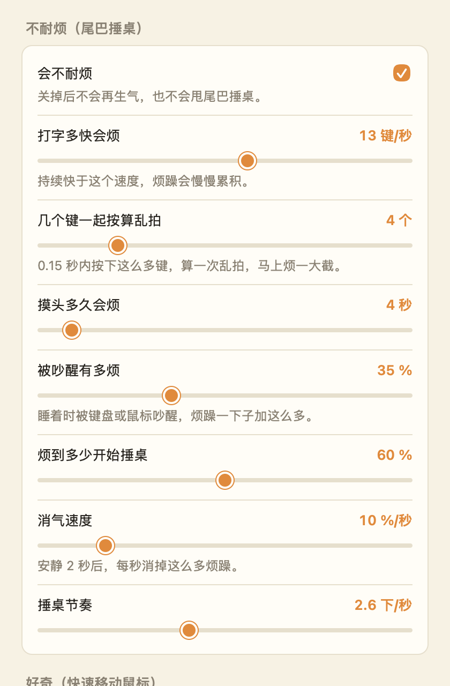

# KeyCat

一只住在菜单栏里的黑猫，趴在键盘上等你打字。敲键盘它伸爪去按，动鼠标它扭头去看，摸头会闭眼，长时间没人理它会睡着，被烦到会用尾巴捶桌子。

macOS 13+，Apple 芯片和 Intel 都能跑，不联网，占用约 1 MB。Windows 版见下方
[「Windows 版」](#windows-版)。



## 安装

### 一行命令安装（推荐）

打开「终端」，粘贴执行：

```sh
curl -L -o /tmp/KeyCat.zip https://github.com/ElloboDK/KeyCat/releases/latest/download/KeyCat.zip \
  && unzip -qo /tmp/KeyCat.zip -d /Applications && open /Applications/KeyCat.app
```

用终端下载的文件不带系统的「下载隔离」标记，装完就能双击打开，不会有任何安全提示。

### 手动安装

1. 从 [Releases](https://github.com/ElloboDK/KeyCat/releases/latest) 下载 `KeyCat.zip` 并解压。
2. 把 `KeyCat.app` 拖进「应用程序」文件夹。
3. 第一次打开会被系统拦下，因为应用没有经过 Apple 公证。在弹窗里点「完成」，然后打开
   **系统设置 → 隐私与安全性**，滚到「安全性」一栏，点「仍要打开」，输入密码确认。
   之后就是普通应用，双击即可。
4. 如果提示「已损坏」或者想跳过第 3 步，在终端执行一次：

   ```sh
   xattr -dr com.apple.quarantine /Applications/KeyCat.app
   ```

> macOS 15 起苹果移除了「右键 → 打开」这个老办法，只能用上面的「仍要打开」。

## 授权

第一次启动时，应用会请求「输入监控」权限。没有这个权限，猫不会跟着键盘动。

- 系统设置 → 隐私与安全性 → 输入监控 → 勾选 KeyCat（如果没有自动弹窗，手动添加
  `/Applications/KeyCat.app`）。
- 授权后需要重启一次 KeyCat。

它只读取按键的按下和松开，不记录内容；鼠标位置只在本地用于让猫转头，不上传任何数据。

## Windows 版

Windows 版把同一套 three.js 场景装进 Electron 外壳（`win/`），住在通知区域。mac 版仍然是那个
不到 1 MB 的原生应用；Windows 版因为带了自己的浏览器内核，安装包约 100 MB。

### 安装

从 [Releases](https://github.com/ElloboDK/KeyCat/releases/latest) 下载 `KeyCat-Setup-x.y.z.exe` 并运行。
安装包没有签名，SmartScreen 可能提示「Windows 已保护你的电脑」：点「更多信息 → 仍要运行」。
安装到当前用户目录，不需要管理员权限。

### 使用

托盘图标左键或右键打开菜单，功能与 mac 版一致：立体效果、毛色、花纹、外观、大小、多久睡着、
隐私模式、调节反应、开机自启、回到右下角、显示/隐藏、检查更新。

- 不需要「输入监控」之类的授权。
- 当前台窗口是以管理员身份运行的程序时，Windows 不会把按键交给普通权限的钩子，猫会不动；
  这是系统限制。
- 猫浮在普通窗口上方，但全屏独占的游戏之上不会显示。

### 自动更新

启动 15 秒后检查一次，之后每 6 小时检查一次 [Releases](https://github.com/ElloboDK/KeyCat/releases)。
新版本在后台下载，下载完成后托盘会弹提示；退出应用时会自动安装，也可以在托盘菜单里点
「重启并更新到 vX.Y.Z」。菜单里始终显示当前版本或「已是最新版本」。

### 从源码构建

需要 Node.js 22+：

```sh
cd win
npm ci
npm start      # 本机调试（mac 上也能跑，方便先看效果）
npm run dist   # 产物在 win/dist：KeyCat-Setup-<version>.exe 和 latest.yml
```

发布新版本：改好 `win/package.json` 的 `version` 并提交，然后推 tag：

```sh
git tag v1.0.1 && git push origin v1.0.1
```

GitHub Actions（`.github/workflows/windows.yml`）会在 Windows 上构建安装包并发布到 Releases，
同时上传自动更新需要的 `latest.yml`。tag 必须和 `win/package.json` 的 version 一致。

## 使用

应用没有 Dock 图标，启动后住在菜单栏（一只键盘图标）。

- **打字**：猫用爪子跟着按键，按下的键旁边浮现键名。
- **动鼠标**：快速甩动鼠标时，猫会瞪大眼睛、竖起耳朵、歪头盯着光标。
- **摸头**：把鼠标停在猫头上按住，它会闭眼、把头往你手心里蹭。
- **拖动**：按住身体可以把它挪开，键盘和鼠标会跟着走。
- **睡觉**：一分钟没动静会趴下睡着，敲键盘或动鼠标会把它吵醒（它有点不高兴）。
- **不耐烦**：疯狂乱敲、摸头太久、或者睡着被吵醒，都会让它生气——飞机耳、眯眼、
  尾巴梆梆梆地捶桌子，还带星星和灰尘特效。

右键猫或点菜单栏图标可以切换毛色（黑/橘/灰/白）、缩放大小、开机自启，
以及打开「调节反应…」。

## 调节反应



菜单里的「调节反应…」打开一个窗口，所有行为参数都能拖：

- 不耐烦：是否启用、多快会烦、几个键算乱拍、摸头多久会烦、被吵醒有多烦、
  烦到多少开始捶桌、消气速度、捶桌节奏。
- 好奇：是否启用、鼠标多快会好奇、瞳孔放大多少、持续多久。

拖动立即生效并自动保存，底部有「让它生气试试」「让它好奇试试」两个按钮用来预览。

## 从源码构建

需要 Xcode 命令行工具（`xcode-select --install`），然后：

```sh
git clone https://github.com/ElloboDK/KeyCat.git
cd KeyCat
./build.sh            # 产物在 build/KeyCat.app
```

`build.sh` 会编译 arm64 和 x86_64 两个架构再合成一个通用二进制。
首次构建时 `tools/sign.sh` 会生成一份本地自签证书，之后的每次构建都用同一个身份签名——
这样「输入监控」授权不会因为重新编译而失效。

打发布包：

```sh
sh tools/package.sh   # 产物 dist/KeyCat.zip 及带版本号的 SHA-256
```

## 结构

```
App.swift         应用入口、透明浮窗、状态栏菜单、拖拽
WebCatView.swift  WKWebView 承载页面、把键盘鼠标事件转发给 JS
KeyMap.swift      虚拟键码 → 键名/手别
Settings.swift    「调节反应」窗口与参数存取
web/core.js       three.js 场景、CROP 取景、弹簧、进度与纹理
web/cat.js        猫的模型：身体、头、耳、眼、爪、尾巴、手臂
web/keyboard.js   键盘与鼠标模型
web/behavior.js   输入 → 状态机 → 动画
web/tuning.js     可调参数的唯一来源
win/main.js       Windows 外壳：托盘、透明浮窗、全局键鼠钩子、自动更新
win/preload.js    把 WKWebView 的消息桥接形状还原成 Electron IPC
win/keymap.js     uiohook 键码 → 键名/手别
win/store.js      设置存取（键名和 mac 版的 UserDefaults 一致）
win/dist/         本地打包产物（不入库）
.github/workflows/windows.yml  推 tag 时构建并发布 Windows 安装包
tools/            开发用的截图、对比、打包脚本
```

## 说明

这是一个从零实现的学习项目，猫的形象和交互参考了一款付费桌面宠物应用，
仅供个人使用和内部交流，不用于商业分发，也不包含对方的任何素材。
界面部分使用 three.js（MIT，见 `web/THREE_LICENSE`），Windows 外壳使用 Electron（MIT）。
